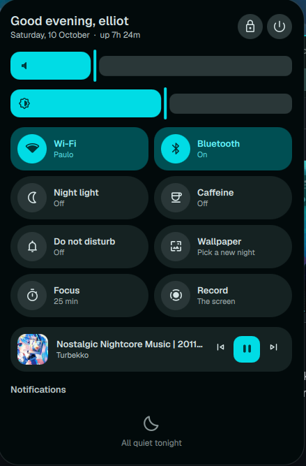
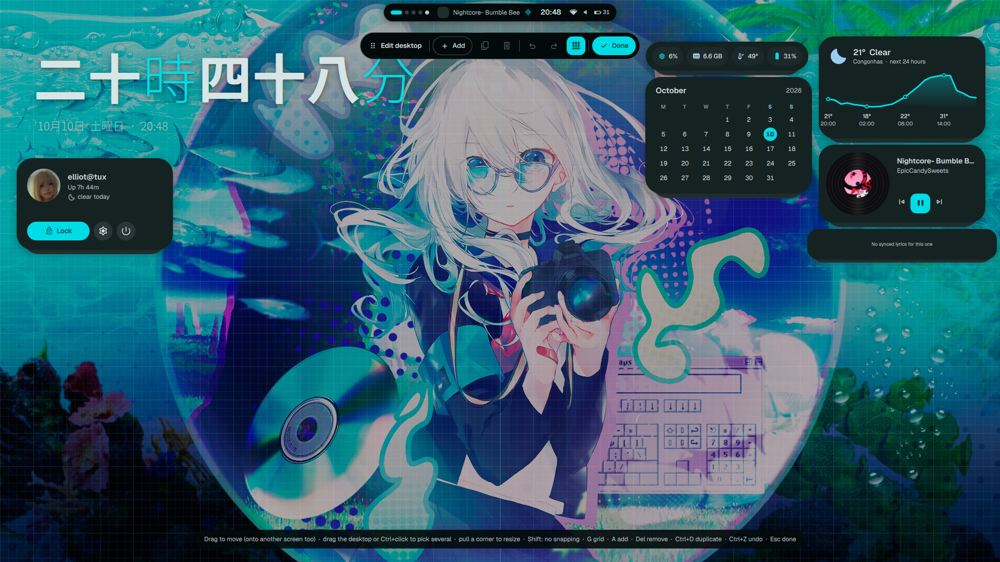
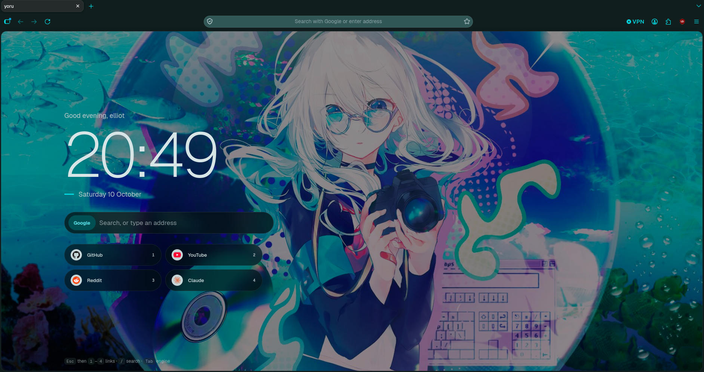
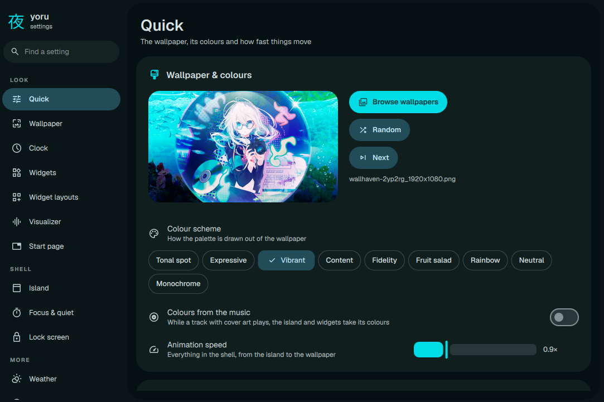

# yoru

夜, night. A Quickshell rice for [aro](https://github.com/simeulinuxkaliaiwr/aro),
[hyprland](https://github.com/hyprwm/hyprland) and [niri](https://github.com/niri-wm/niri). [Demonstration video](https://youtu.be/SwnPey0mfXo?si=V4ve6P0GJIUeT3nZ)

| | |
|---|---|
|  |  |
|  |  |

### The island

One dark shape at the top of the screen is the whole shell. At rest it shows
the workspaces, what's playing, the time and the status. It morphs into the
launcher, clipboard, control center, media player, calendar, wallpaper picker
and power menu. It also shows notification pop-ups, brightness and volume. **Control center demonstration:**

### The phone (mod+y)

A phone that drops out of the island, holding your apps, quick settings, the day and the music
on pages you swipe (or Tab) between:

- **Home**: a clock in any of the desktop's styles, the weather, your apps and a dock. Type
  anywhere and it searches them; what isn't an app (maths, the web, emoji) goes on to the
  island's launcher.
- **Control**: your battery, Wi-Fi and Bluetooth (with lists to join networks and pair
  devices), tiles for night light, caffeine, do not disturb, focus, recording and more, what's
  playing, brightness and volume, and how busy the computer is.
- **Today**: the weather by the hour, the month, the focus timer and your notifications.
- **Music**: the cover, the controls, and the words as they're sung.

Under Settings → Phone, pick its body: a glass **slab** whose side buttons work, a **flip**
phone that swings open on its hinge (its keypad's 1–9 are shortcuts you choose), or the
**bare** screen. Also choose where it stands, how it comes, its screen, which pages and in what
order, which tiles, and more. It follows your colours and modes like the rest of yoru.

### The wallpaper

Drawn by the shell: it drifts with the workspaces (parallax, optional), plays videos
(paused while windows cover it, you can disable this).

Or let [skwd-wall v2](https://github.com/liixini/skwd-wall) draw it: pick "skwd-wall" under
Settings → Wallpaper → Drawn by (or run `yoru backend skwd`). Its daemon then shows the
wallpaper with its own transitions and players, and yoru keeps taking the colors, also from
whatever you pick in skwd's own picker (Wallpaper Engine scenes included). yoru's weather still
falls over it, and yoru pauses skwd's videos under your windows. The same settings page has
skwd's transitions (with its sand ones), video sound, battery saver and idle pause, whether
mod+w opens yoru's picker or skwd's, and buttons for skwd's picker, mixer and settings.
Needs `skwd-wall-v2-bin` and `skwd-deck-bin` (AUR); `yoru backend yoru` goes back.

### Colors from the wallpaper

When you set a wallpaper, yoru gets its colors and applies them to the shell and to your apps. When it's a video wallpaper, the colors change live (in the shell, not in GTK apps etc.).

### Wallpaper transitions

Currently, there are 8 wallpaper transition animations: ripple, fade, wipe, disc, stripes, zoom, honeycomb and pixelate (or a random
one each time), you can adjust its duration. **Stripe wallpaper transition animation demonstration:**

https://github.com/user-attachments/assets/59dd98a2-d774-49e4-9f99-9d3c45c83046

### Wallpapers by time of day!

Optional: your dark wallpapers are applied at night, your bright ones by day, and the softer ones by dawn/dusk! "How does yoru know if it's day or not?" Well, by your location! The default one uses your IP. You can choose a folder for each period of the day.

### Weather on the wallpaper

Snow, rain, fog or a storm falls over the picture when it does outside
(yoru uses [open-meteo api](https://open-meteo.com) to know the weather of where you live), and even an aurora when it's a clear night! Want to know what it looks like? Go see the [aurora](docs/aurora.png), the [snow](docs/snow.png) and the [storm](docs/storm.png)!

### The desktop

Yoru has many widgets, a clock with several styles, a weather widget, a calendar widget, a system usage widget and more! See the edit mode "add" section to see all of them!

### Edit mode (mod+e)

Yoru has an edit mode, HEAVILY inspired by [noctalia's](https://github.com/noctalia-dev/noctalia) edit mode. You can edit the widget's position, which widgets you want, which widgets you don't and their styles.

### Notifications

Yoru keeps your last 100 notifications, even when you restart your pc! You can find them on the control center.

### Firefox theme

Yoru has a rounded firefox theme! Take a look at it:

### Config window

Yoru has a configuration window HEAVILY inspired by [end-4's](https://github.com/end-4/dots-hyprland), that's where you configure EVERYTHING: your wallpaper, the color palette, the widget's styles, the startpage, the weather and more.

## Install

    git clone https://github.com/simeulinuxkaliaiwr/yoru ~/yoru
    ~/yoru/install.sh

The install script installs dependencies, and sets up yoru for the compositor that's running (aro, hyprland or niri), but you can choose it yourself by running `./install.sh aro/hyprland/niri`.

| | the line you must add to use yoru | what it does |
|---|---|---|
| Hyprland 0.56+ | `require("yoru")` in `hyprland.lua` | brings [config/hypr/yoru.lua](config/hypr/yoru.lua) |
| older Hyprland | `source = ~/.config/hypr/yoru.conf` | brings [config/hypr/yoru.conf](config/hypr/yoru.conf) |
| niri | `include "yoru.kdl"` in `config.kdl` | brings [config/niri/yoru.kdl](config/niri/yoru.kdl) |
| aro | yoru's whole aro config | [config/aro/config](config/aro/config) |

Why do you need to do that? So your compositor gets the border colors, and keybinds.

Dependencies: see [docs/dependencies.txt](docs/dependencies.txt)

You can start the shell by the command `yoru-shell`.

If you want to install firefox's theme and the startpage, run `sudo install -m644 config/firefox/mozilla.cfg /usr/lib/firefox/`

## Keybindings

| | |
|---|---|
| `mod+a` | Smart launcher with web search support, emoji and can run commands and search for applications. |
| `mod+v` | Clipboard history |
| `mod+x` | Control center |
| `mod+m` | Media player |
| `mod+w` | Wallpaper selector |
| `mod+shift+w` | Next wallpaper |
| `mod+shift+e` | Open the power menu |
| `mod+i` | Open config window |
| `mod+e` | Open edit mode |
| `mod+y` | Open the phone |
| `mod+Tab` | window picker (type to filter) |
| `mod+/` | Keybindings cheat-sheet |
| `mod+p` | 25m timer to focus |
| `mod+shift+c` | Color picker |
| `mod+shift+Print` | Record your screen |
| `mod+ctrl+Print` | Record only an area of your screen |
| `mod+escape` | Lock your screen |
| `mod+o` | Overview, only if you're on aro |
| `Print` | Screenshot your screen |
| `Super+Print` | Screenshot only an area of your screen |

## Yoru IPC commands

Run `yoru` to see available commands.
