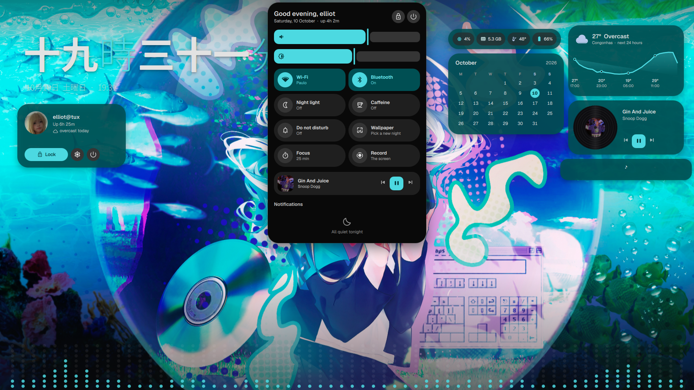
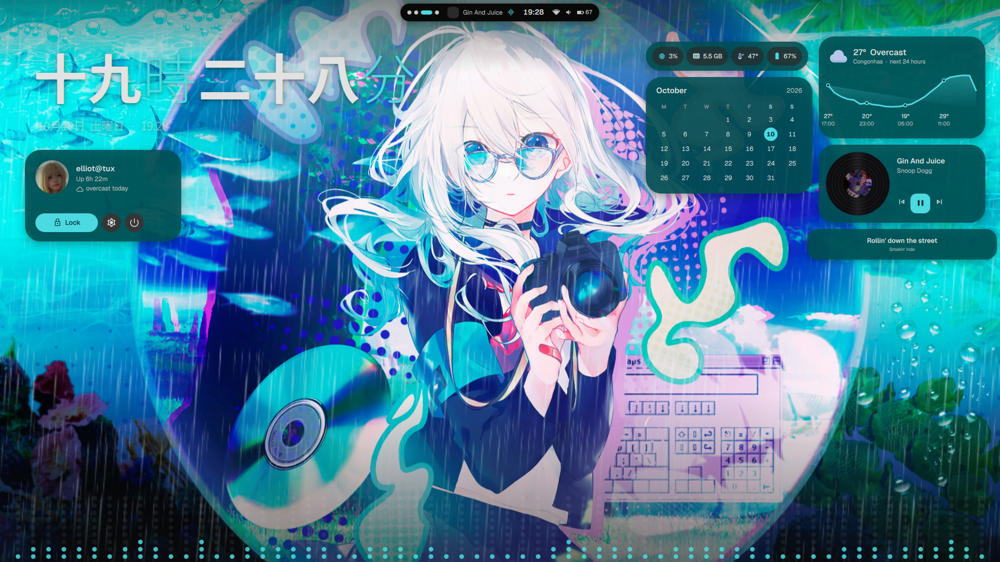
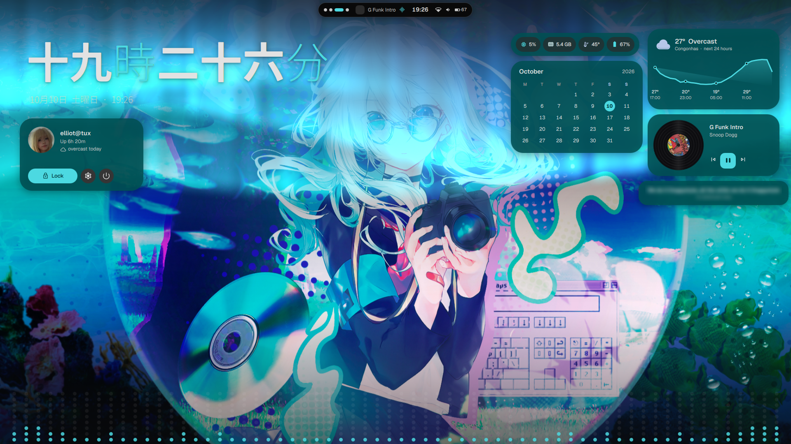

# yoru

夜, night. A Quickshell rice for [aro](https://github.com/simeulinuxkaliaiwr/aro),
Hyprland and niri. On aro it sits beside [kon](https://github.com/simeulinuxkaliaiwr/kon),
and one key swaps between them.

Dark, with colours taken from the wallpaper and motion everywhere.

| | |
|---|---|
|  |  |
|  |  |

### The island

One dark shape at the top of the screen is the whole shell. At rest it shows
the workspaces, what's playing, the time and the status. It morphs into the
launcher, clipboard, control centre, media player, calendar, wallpaper picker
and power menu, and briefly into volume, brightness and notification popups.

### A living wallpaper

Drawn by the shell: it drifts with the workspaces (parallax), plays videos
(paused while windows cover it), and a new one ripples out of the island
through a GPU shader.

### Live wallpapers that colour the shell

A video's palette comes from frames across its whole loop, and the island and
widgets drift with its scenes as it plays (worked out once, in the background,
then cached). Videos can keep playing under windows, or pause to save battery.

### Colours from the wallpaper

Material 3 roles from matugen, faded across the shell and pushed into the
compositor's borders (aro, Hyprland, niri), foot (and open terminals), GTK,
fuzzel, swaylock, btop, cava, starship and fastfetch. Configs yoru writes over
whole are kept first as `NAME.pre-yoru`.

### Wallpaper transitions

Ripple, fade, wipe, disc, stripes, zoom, honeycomb and pixelate (or a random
one each time), with adjustable length and edge softness. The shell draws the
wallpaper itself; with none yet, it paints its own night sky.

### Wallpapers by time of day

Optional: dark ones at night, bright ones by day, softer ones at dawn and
dusk, by your city's sunrise and sunset. yoru sorts the folders by brightness
itself, or each period takes its own folder.

### Weather on the wallpaper

Snow, rain, fog or a storm falls over the picture when it does outside
(Open-Meteo), slanted by the real wind, and an aurora drifts across the top on
clear nights. Or pick one to keep. It stands still under windows, like a
video.

### The desktop

A clock in ten styles (thin, bold, stacked, outline, mono, split, words,
kanji, serif, analog), widgets (today, weather, calendar, system, now
playing), each with its own layouts (weather: card, hero, pill, a 24-hour
graph, split; calendar: month, week, a tear-off date, dots; system: rings,
bars, chips, a history graph; now playing: card, cover, pill, a turning
record; today: bars, rings, the sun's arc), in a column, a grid, a row under
the island, or placed by hand. They sit on ten looks (glass, frosted, solid,
tonal, gradient, stack, outline, neon, HUD, minimal), and a visualizer rises
while music plays (bars, mirror, wave or dots).

### Edit mode (mod+e)

The desktop's widgets, live, over everything: drag them where you like (they
snap to a grid, the screen's middle and edges, and each other), pull a corner
to resize, give each its own layout, look and size, pick several (Ctrl+click,
a lasso, Ctrl+A) to move them together, drag them onto another monitor, undo
anything. Add more from a palette of live previews, as many as you like,
including eleven that only live here: a clock in any style or a Material
cookie, world clocks, synced lyrics (from lrclib.net, stretched to fit
nightcore and slowed uploads), a photo or a folder slideshow cut to a shape,
notes, a to-do list you tick off on the desktop, focus/stopwatch/countdown
timers, a quote of the day, a user card, app shortcuts, and a countdown to a
date.

### A lock screen

The wallpaper blurred, a big clock, your picture (`~/.face`), a password pill
whose characters pop in as Material shapes (or dots) and that shakes at a
wrong password, the music and power buttons. If the shell ever dies while
locked, the session stays locked (ext-session-lock): on aro,
`WAYLAND_DISPLAY=wayland-0 aro-lock` from a TTY takes over and unlocks.

### Notification history

Every notification is kept (the last 100, across restarts) in the control
centre, grouped by app with how long ago it came, so nothing that arrived
during do not disturb is lost. The island's dot means new ones you haven't
seen.

### Live activities

A focus timer (with a break, notifications held while you work, the music
paused for the break and played again after, optional rounds, a count of
today's sessions, and its time on the lock screen), screen recording, a colour
picker and quiet hours, all shown in the island. While a track with cover art
plays, the shell takes its colours from the cover.

### Firefox

Pill tabs, a rounded address bar and the page as a floating card, coloured
live from the wallpaper through Pywalfox, and a yoru start page with its own
settings: three layouts, your links, the greeting, the search engine, and new
tabs that type straight into its search. Your own Firefox CSS is kept as
`chrome/kon.css` (on aro, `rice kon` brings it back; shapes change on
Firefox's next start, colours at once).

### Settings (mod+i)

A window in the style of end-4's, with search and live previews: Quick,
Wallpaper, Clock, Widgets, Widget layouts, Visualizer, Start page, Island,
Focus & quiet, Lock screen, Weather, About. It writes
`~/.config/yoru/config.json`, which the shell follows live.

## Install

    git clone https://github.com/simeulinuxkaliaiwr/yoru ~/yoru
    ~/yoru/install.sh

The installer sets up whichever of aro, Hyprland and niri you're in (or every
one installed; `./install.sh hyprland niri` picks). On Arch it installs what's
missing first with `sudo pacman -S --needed …` (it shows the command, then asks
for your password), and wl-screenrec through paru or yay if you have one.
Elsewhere it lists the packages by their Arch names. Then it links the shell
and its scripts into `~/.config` and `~/.local/bin`, fetches the Geist,
Material Symbols, Noto Sans JP and Instrument Serif fonts and the Bibata
cursor, and adds one line to your compositor's config, asking first and
keeping a backup:

| | the line | what it brings |
|---|---|---|
| Hyprland 0.56+ | `require("yoru")` in `hyprland.lua` | [config/hypr/yoru.lua](config/hypr/yoru.lua) |
| older Hyprland | `source = ~/.config/hypr/yoru.conf` | [config/hypr/yoru.conf](config/hypr/yoru.conf) |
| niri | `include "yoru.kdl"` in `config.kdl` | [config/niri/yoru.kdl](config/niri/yoru.kdl) |
| aro | yoru's whole aro config, or `rice yoru` beside kon | [config/aro/config](config/aro/config) |

Each starts the shell, gives yoru its keys (below) and colours the borders
from the wallpaper. On Hyprland 0.56 and niri, yoru's keys replace any of yours
on the same keys; older Hyprland runs every bind on a key, so unbind your own
first. Run the installer again any time: it only adds what's missing.

The packages: quickshell, matugen, imagemagick, jq, curl, python, libarchive
and fontconfig, which yoru can't run without, and for the features that use
them ffmpeg (video wallpapers), cava, cliphist, wl-clipboard, grim and slurp,
wl-screenrec, hyprpicker, brightnessctl, wireplumber, playerctl, libqalculate,
networkmanager, wlsunset, swayidle, swaylock, zenity, inotify-tools, libnotify
and noto-fonts-emoji. With no weather city set, the weather finds yours from
your IP (ipinfo.io).

`yoru-shell` starts the shell: it raises the open-file limit, keeps NVIDIA's
driver out on machines that have it installed but no NVIDIA card, and restarts
the shell when its files change.

Firefox's start page and its empty, ready-to-type new tabs need a small
loader installed once, as root (the start page's settings show this too):

    sudo install -m644 config/firefox/mozilla.cfg /usr/lib/firefox/

## Switching (aro, with kon)

`rice` keeps one aro config per rice. The live `~/.config/aro/config` belongs
to the rice that is on; the other waits as `config.kon` or `config.yoru`.
Edits to the live one follow it when you switch. The very first switch keeps
`config.bak-before-rice`.

    rice                which is on
    rice toggle         the other one   (mod+ctrl+r)

## Keys

| | |
|---|---|
| `mod+a` | launcher: apps, maths and units, `:` emoji, `?` web search, `>` a command |
| `mod+v` | clipboard, with previews of images and whole texts |
| `mod+x` | control centre |
| `mod+m` | player |
| `mod+w` / `mod+shift+w` | wallpaper picker / next wallpaper |
| `mod+shift+e` | power |
| `mod+i` | settings |
| `mod+e` | edit the desktop's widgets |
| `mod+Tab` | window picker (type to filter) |
| `mod+/` | every key, read from your aro, Hyprland or niri config |
| `mod+p` | focus timer |
| `mod+shift+c` | pick a colour |
| `mod+shift+Print`, `mod+ctrl+Print` | record the screen, an area |
| `mod+escape` | lock |
| `mod+o` | aro's overview |
| `Print`, `mod+Print` | screenshot, area |
| `mod+ctrl+r` | back to kon (aro) |

On aro the rest are kon's: `mod+hjkl`, workspaces, scratchpad, groups. On
Hyprland and niri the rest are your own.

## Wallpapers

    yoru wall FILE      an image or a video
    yoru wall next
    yoru walls          what the picker lists (the folders are in Settings → Wallpaper;
                        ~/Pictures/yoru and ~/Pictures/Wallpapers to begin with)
